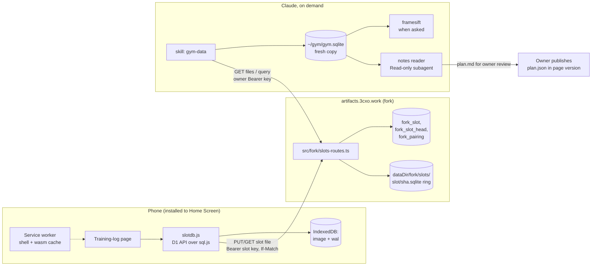

# Overview

**Fallback design.** The main plan is [Data slots](/features/data-slots.md), built on Turso sync. This version is kept complete so it can be built if the Turso test in phase 1 fails.

**Status: not built.** This is the implementation plan, written before any code. Phases 0–2 below are tests that can still change it.

A published page often needs to save data: a training log, a checklist, notes. The owner wants that data on his own server, with Cloudflare D1-style SQL in the page and no per-page server code.[^requester]

The design, chosen after two council runs:[^council1][^council2]

- **The phone holds the record.** Each person's data is a real SQLite file in the page (sql.js), stored in the browser. The page uses a D1-style API on it. Logging works in airplane mode.
- **The server is a mailbox.** It keeps the latest copy of each person's file in a "slot". It never runs SQL sent by a page.
- **The owner can query on the server.** An owner-only, read-only SQL endpoint opens the latest files and joins both people's logs.
- **History is kept in the file.** An append-only `_journal` table records every change, so edits, undos and corrections can be analysed later.
- **A skill is the reader.** When the owner asks for an analysis, Claude's `gym-data` skill queries or downloads the slot files. Nothing runs in the background.
- **Video never touches the server.** The page stores time markers; clips stay in the camera roll and are matched on the Mac.

Rejected on the way: raw SQL per artifact on the server (needs an authorizer, DDL roles, query limits), rqlite (still needs an identity gateway, and adds a process), an ordered statement log replayed by every phone (replay and determinism rules for no gain with one writer per file), and a video relay through the server (Safari encode risk, inbox to watch).

# Architecture



# Server (fork)

## Data model

New tables, created in the store constructor like the share-code table (`CREATE TABLE IF NOT EXISTS … STRICT`):

| Table | Columns | Notes |
|-------|---------|-------|
| `fork_slot` | `id`, `artifact_id`, `person`, `key_hash`, `created_at`, `revoked_at`, `client_meta` (JSON), `last_put_at` | One row per person per artifact. `person` is a stable label ("wife", "owner"), so data survives key rotation. |
| `fork_slot_head` | `slot_id`, `sha256`, `size`, `seq`, `updated_at` | The current file. `seq` increases on every accepted PUT. |
| `fork_pairing` | `code_hash`, `slot_id`, `expires_at`, `used_at` | One-time pairing codes, 15 minutes, single use. |

Files live in `<dataDir>/fork/slots/<slot_id>/<sha256>.sqlite`, **not** in the content-addressed blob store (which cannot delete). The server keeps the current file plus the 4 previous ones and unlinks older ones. This directory holds only this feature's files, so the delete is safe.

## Routes

All on the app origin `artifacts.3cxo.work`, in `src/fork/slots-routes.ts`. No MCP tool (avoids editing the two MCP dependency interfaces and the tool-count test).

| Route | Auth | Purpose |
|-------|------|---------|
| `POST /api/v1/fork/slots` | owner Bearer | Create a slot: `{artifactId, person}` |
| `POST /api/v1/fork/slots/:id/pairing` | owner Bearer | Issue an 8-character pairing code |
| `POST /api/v1/fork/pair` | none, rate-limited | Exchange a pairing code for `{slotId, slotKey, artifactId, partnerSlotIds}` |
| `GET /api/v1/fork/slots/:id/file` | slot key of the same artifact, or owner | Current file, with `ETag: <sha256>` |
| `PUT /api/v1/fork/slots/:id/file` | the slot's own key | Replace the file. Needs `If-Match: <sha256>` (or `If-None-Match: *` the first time). Returns `200 {sha256, seq}` or `412` |
| `GET /api/v1/fork/slots?artifact=` | owner Bearer | List slots with head, size, `last_put_at`, `client_meta` |
| `POST /api/v1/fork/slots/:id/rotate` | owner Bearer | Revoke the key; the slot and its history stay |
| `POST /api/v1/fork/slots/query` | owner Bearer | Read-only SQL across the artifact's latest slot files (see below) |

**PUT checks, in order:** key hash matches and slot not revoked → `If-Match` equals the head → body at most 5 MB → first 16 bytes are `SQLite format 3\0` → stream to a temp file, hash, rename → update head in one transaction → prune the ring. `X-Client-Meta` (storage kind, `persisted()`, oldest unsynced age, page version) is saved on the slot row.

**CORS:** the page runs on `*.art.3cxo.work` and calls the app origin. Allow origins matching `^https://[a-z0-9-]+\.art\.3cxo\.work$`, methods `GET, PUT, POST`, headers `Authorization, If-Match, If-None-Match, Content-Type, X-Client-Meta`, and **no credentials**. Auth is the Bearer slot key only, so there are no ambient cookies and no CSRF surface.

**Limits:** pairing attempts 10 per client and 50 per slot per 15 minutes (in memory, like share codes).[^share-codes] PUT 1 per 5 seconds per slot. nginx `client_max_body_size 6m` on `/api/v1/fork/slots/` for the app host (the default is 1 MB).

## Owner query

`POST /api/v1/fork/slots/query` with `{artifact, sql, includeText}` and the owner's Bearer key. Page keys can never call it.

1. Open the latest file of each slot **read-only**, with `PRAGMA trusted_schema=OFF` and `query_only=ON`.
2. Reject a file whose schema has triggers or views that are not on the allowlist.
3. `ATTACH` each file under its `person` label (`wife`, `owner`), so one query can join both logs.
4. Accept exactly one `SELECT` (or `WITH … SELECT`). Limits: 2 seconds, 5,000 rows, 2 MB response.
5. Free-text columns (`notes.body`, `comments.body`, `_journal.params`) come back as `[text: N chars]` unless `includeText: true`.

An optional MCP tool, `artifact_slots_query`, wraps the same call. It needs the two MCP interface edits and the tool-count test change, so it is a separate, later step.

## Fork layout and upstream edits

```text
src/fork/
  register.ts          registerForkRoutes(app, deps)
  slots-store.ts       SQLite tables and statements (node:sqlite)
  slots-service.ts     pairing, PUT rules, ring pruning
  slots-routes.ts      Hono routes and CORS
tests/fork/
  slots.test.ts        Vitest, real server (runtime-harness)
deploy/3cxo/
  fork-backup.sh       online DB snapshot + blob backup (see Operations)
```

Edits to upstream files: one `registerForkRoutes(app, deps)` call where `createHttpApp` assembles routes (`src/http/create-http-app.ts`), and constructing and closing the store in `src/local/create-local-runtime.ts`, following the share-code store's pattern.[^code-survey] On Postgres and Cloudflare runtimes the routes answer `CAPABILITY_UNAVAILABLE`.

# Phone

## Install and pairing

iOS gives a Home Screen web app **storage separate from Safari**, and exempts it from Safari's 7-day storage cap. So installing is the first step, not a later one:

1. The owner sends the page link. In plain Safari (`navigator.standalone` is false) the page shows only "Add to Home Screen, then open it from there". It logs nothing.
2. The installed app has no key yet. It shows one input: "Enter your pairing code".
3. The owner creates a code (`POST …/pairing`) and sends it. The app exchanges it for the slot key, stores the key in IndexedDB, and calls `navigator.storage.persist()`.
4. If the slot already has a file, the app downloads it first and says how old it is ("restored from Thursday"). It never shows an empty log when a slot exists.

## slotdb.js (vendored into each page)

A small library copied into every page that uses data (about 5 KB plus sql.js). Pages pin the version they were tested with.

```js
const db = await slotdb.open({ migrations: [
  "CREATE TABLE sets (id TEXT PRIMARY KEY, date TEXT, exercise TEXT, kg REAL, reps INT, effort INT, flagged INT DEFAULT 0)",
  "CREATE TABLE markers (id TEXT PRIMARY KEY, set_id TEXT, started_at TEXT, ended_at TEXT)",
  "CREATE TABLE notes (id TEXT PRIMARY KEY, session_date TEXT, at TEXT, body TEXT)",        // journal
  "CREATE TABLE comments (id TEXT PRIMARY KEY, target TEXT, target_id TEXT, at TEXT, body TEXT)",
]});   // slotdb.js adds _outbox and _journal itself
await db.prepare("INSERT INTO sets (id, date, exercise, kg, reps, effort) VALUES (?,?,?,?,?,?)")
        .bind(crypto.randomUUID(), today, "leg press", 30, 12, 7).run();
const last = await db.prepare("SELECT * FROM sets WHERE exercise = ? ORDER BY date DESC LIMIT 4").bind("leg press").all();
const partner = await db.partner();   // read-only copy of the partner's file
```

| Concern | Rule |
|---------|------|
| History | Every `run()`/`batch()` also inserts a `_journal` row in the same transaction: `id, at, device, op, tbl, row_id, sql, params`. Never pruned; a few KB a month. |
| Storage | IndexedDB holds `image` (the last full export) and `wal` (statements since that export). |
| Write | Run the statement in sql.js and insert an `_outbox` row in the same transaction. Then put one small `wal` entry in IndexedDB **before** returning. Export the full image every 20 writes, on `visibilitychange` to hidden, and before each PUT. |
| Open | Load `image`, re-apply `wal` entries newer than it, run missing migrations. A file whose `schema_version` is newer than the page shows "update the app" and is not changed. |
| One writer | A Web Lock per slot. A second tab shows "open in the other tab". |
| Sync | 10 seconds after the last write, or when back online: export, then `PUT` with `If-Match`. On `200`, mark the `_outbox` rows acknowledged. On `412`, download the head, re-apply this device's unacknowledged `_outbox` rows (IDs and timestamps are bound parameters, so this is safe to repeat), then PUT again. |
| Row status | Grey clock = only on the phone (row ID in unacknowledged `_outbox`); green tick = on the server. A 401 shows one banner: "This device was signed out. Ask for a new pairing code." |
| Determinism | IDs come from `crypto.randomUUID()`, timestamps are bound parameters. |
| Offline | A service worker caches the page and `sql-wasm.wasm`. HTML is network-first, so a new version loads when online. |

## The training-log page

The set screen comes first and must pass one test on the wife's phone: with weak signal, she sees last week's weight and logs a set in under 5 seconds.

- One exercise at a time, in plan order. Last session's sets shown in the header.
- The next set is pre-filled from the same set last session (or the plan target). A large **Same again** button logs it with one tap.
- Steppers for weight and reps, a 1–10 row for effort, fixed chips for notes (knee, too heavy, no time). No keyboard on this screen.
- 10-second undo after each set (the entry waits in the outbox and is never sent if undone).
- A set far from last session (weight above 1.5× or below 0.5×, reps 0 or above 30) asks one confirming tap and is stored with `flagged = 1`.
- A **filming** toggle on the set row writes a marker (`set_id`, start, end).
- User text is rendered with `textContent` only.

# The gym-data skill

No launchd jobs. Analysis happens only when the owner asks ("how did this week go?", "check her squat form"). A Claude skill, `gym-data`, holds the steps. It uses `art-get`, a helper like `art-put` that reads the owner's API key itself and only calls `artifacts.3cxo.work`.

| Step | What the skill does |
|------|---------------------|
| 1. Fetch | For a quick question, call the owner query endpoint (free text hidden). For deeper work, download the latest slot files into `~/gym/`: open read-only with `trusted_schema=OFF`, check the schema allowlist, copy into `~/gym/gym.sqlite`, and keep a dated copy. |
| 2. Health line | Print one line per person first: last write, oldest unsynced, storage persisted or not. A person silent for 10 days is called out before any analysis. |
| 3. Notes | Free text (notes, comments, journal values) is read only by a subagent with `Read` as its only tool and no MCP servers. It returns a fixed summary: tags, pain mentions, mood, no free-form instructions. |
| 4. Video | Only when asked: match camera-roll clips to set markers by time, run framesift, keep keyframes on the Mac. |
| 5. Plan | Write `plan.md`. The owner reviews it as a diff, then a normal session publishes `plan.json` in a new page version. |

Trade-off: with no background job there is no automatic off-site copy and no "partner stopped logging" alert. The server backups cover data safety, each skill run leaves a dated local copy, and the health line covers silence when the owner next asks.

# Operations

Fix before anything else; the nightly backup cron is broken today.

- **Database:** a nightly online snapshot taken inside the container with `node:sqlite` (`backup()` or `VACUUM INTO`), then `PRAGMA integrity_check`, then a Healthchecks.io ping carrying size and hash. The deploy stops tarring the live WAL database.
- **Blobs:** `rsync --link-dest` snapshots. The script fails if the second snapshot's link count is 1 (different filesystems; then switch to restic instead).
- **Retention:** 7 nightly, 4 weekly, 5 pre-deploy, one `find -mtime` line.
- **Free-space floor:** the deploy and the backup abort before stopping anything when free space on the volume's filesystem is under 2 GB.
- **Restore drill:** restore into a scratch compose, open the app, load one blob. A hard gate after phase 0 and after every upstream merge that changes a migration.
- **Alerts (all Healthchecks.io, free plan):** nightly backup, disk floor, monthly upstream dry-run merge plus tests. Partner silence shows in the skill's health line.
- **Slot storage:** two people × 5 files × about 1 MB, under 20 MB. Videos never reach the server.

# Security

| Threat | Control |
|--------|---------|
| A leaked page link | Reads nothing and writes nothing without a slot key. |
| A leaked slot key | Can overwrite that person's file within 5 MB and read the partner's file. Recover from the server ring or the Mac's dated copies, then rotate the key. |
| An empty or wiped phone overwrites good data | `If-Match` returns 412; the phone must merge first. |
| Pairing code guessing | 8 characters, 15 minutes, single use, rate-limited. |
| A hostile SQLite file reaches the Mac | The skill opens it read-only with `trusted_schema=OFF`, checks the schema allowlist, and copies into a clean file. |
| Prompt injection through notes | Free text is read only by a Read-only subagent that returns a fixed summary. The owner query hides free text unless `includeText` is set. The owner reviews every plan. |
| Abuse of the query endpoint | Owner key only; read-only open; one `SELECT`; time, row and size limits. |
| Script injection in the page | `textContent` only. |

# Build plan

| Phase | Work | Gate |
|-------|------|------|
| 0 | Backup fix and restore drill on `3cxo` | Restore drill passes. Owner confirms before host changes. |
| 1 | iPhone spike on the wife's phone: install, pair by code, airplane-mode logging, force-quit 50 times during a save, `persisted()`, insert plus export time at 1 MB | No lost set; export under 100 ms; key survives install. If export is slow, switch to wa-sqlite with an IndexedDB VFS. |
| 2 | Saturday test: set screen on fake data, stopwatch | Under 5 s per set, zero keyboards. |
| 3 | Server: `src/fork/` slots, pairing, CORS, nginx limit, owner query, tests (`pnpm verify:iteration`, `pnpm smoke`) | Tests for 412 merge, revoked key, wrong artifact, oversize, bad header, CORS origin, query rejects non-SELECT / page keys / hidden text. Deploy after owner confirms. |
| 4 | `slotdb.js`: D1 API, outbox, journal, merge, lock, service worker | Scripted tests: two devices interleaved, wipe and restore, PUT killed mid-transfer. |
| 5 | Training-log page | Two weeks of real use; at least 70% of sets logged. |
| 6 | `gym-data` skill, `art-get` helper, plan publish | One full plan cycle from a real week of logs. |
| 7 | Video: transport test (3 clips, timestamps, `osxphotos` on macOS 27), then the skill's video step | At least 80% matched over two weeks; otherwise keep the server relay design as the fallback. |

# Open questions

- Does the Home Screen app keep a URL fragment? The design does not depend on it (pairing code), but it would simplify setup.
- Two devices per person (phone and tablet) pair to the same slot and merge through `412`. Same-row edits resolve last-writer-wins; acceptable for a personal log.
- **Shared data across people** (a joint plan, a leaderboard) does not fit one file per person. If a future page needs it, the ordered statement log from the first synthesis is the candidate, reusing this feature's pairing and key model.
- Upstream may add its own per-artifact data feature or blob GC. Check upstream issues before phase 3.

[^requester]: Training log with photos, text and short video; D1-style DX; own server; rqlite idea
[^council1]: First council (adversary, minimalist, operator) on the per-artifact database proposal
[^council2]: Second council (user advocate, first principles, pre-mortem) on the synthesis design
[^code-survey]: Code survey of routes, share-code grants, blob store, MCP wiring and backups (2026-10-03)
[^share-codes]: Artifact share codes
