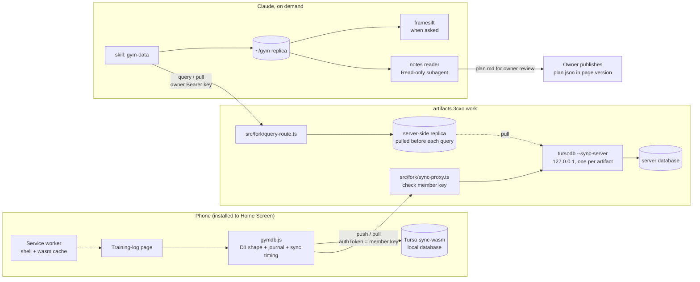

# Overview

**Status: not built.** This is the implementation plan, written before any code. Phases 0–2 below are tests that can still change it.

A published page often needs to save data: a training log, notes, comments. The owner wants that data on his own server, with D1-style SQL in the page and no per-page server code.[^requester]

The design, chosen after two council runs and the owner's decision to build on Turso:[^council1][^council2]

- **The phone holds a real database.** The page uses Turso's browser database with sync (`@tursodatabase/sync-wasm`). Logging works offline; `push()` and `pull()` sync when there is signal.[^turso-sync]
- **The server runs a Turso sync server.** One `tursodb --sync-server` per data-enabled artifact, bound to localhost. It holds a live SQLite-compatible database.[^turso-local]
- **The fork is the gatekeeper.** Turso's self-hosted sync server has no authentication, so every sync request goes through a fork route that checks the person's key and forwards it.
- **The owner can query on the server.** An owner-only, read-only SQL endpoint answers from a server-side replica.
- **History is kept in the database.** An append-only `_journal` table records every change.
- **A skill is the reader.** When the owner asks for an analysis, Claude's `gym-data` skill queries or pulls the data. Nothing runs in the background.
- **Video never reaches the server.** The page stores time markers; clips stay in the camera roll and are matched on the Mac.

**Maintenance stance.** Turso is pre-1.0 (`sync-wasm` 0.8.1 on 2026-10-03).[^turso-wasm] The owner accepts that and will fix or patch problems. Both `tursodb` and the browser package are pinned to exact versions and upgraded together, after the phase 1 test suite passes again.

**Fallback.** If the phase 1 test fails, build [the whole-file slot design](/features/data-slots-fallback.md) instead: a page-side sql.js file uploaded with `If-Match` to a content-blind mailbox. Its pairing, query endpoint and skill match this design; only the sync layer differs.

# Architecture



# Server (fork)

## Turso sync server

- One `tursodb <artifact>.db --sync-server 127.0.0.1:<port>` per data-enabled artifact. Today that is one: the training log.
- Runs as its own container in a fork-owned compose override, on a new named volume `turso-data`, never published outside the compose network.
- **Host note (2026-10-21):** 3cxo no longer runs Docker or compose; containers there are rootful Podman quadlet units on the shared `podman` bridge (see [Artifact Server on 3cxo](/deployment/3cxo-host.md)). Build this as a `turso-sync.container` quadlet with a bind mount, or as a plain systemd unit like the existing `datakit-turso@<app>.service` instances on the same host (one already serves `training-log` on 127.0.0.1:8091). Not re-planned yet.
- The image pins an exact `tursodb` version.
- One database per artifact, shared by both people. Rows use UUID primary keys, so their inserts do not collide. A `person` column on each table says whose row it is.

## Data model (fork tables, `CREATE TABLE IF NOT EXISTS … STRICT`)

| Table | Columns | Notes |
|-------|---------|-------|
| `fork_data_db` | `artifact_id`, `upstream_url`, `tursodb_version`, `created_at` | Which artifact has data, and where its sync server listens. |
| `fork_member` | `id`, `artifact_id`, `person`, `key_hash`, `created_at`, `revoked_at`, `client_meta`, `last_seen_at` | One row per person per artifact. `person` is a stable label, so data survives key rotation. |
| `fork_pairing` | `code_hash`, `member_id`, `expires_at`, `used_at` | One-time pairing codes: 15 minutes, single use. |

## Routes

All on the app origin `artifacts.3cxo.work`, in `src/fork/`.

| Route | Auth | Purpose |
|-------|------|---------|
| `POST /api/v1/fork/data` | owner Bearer | Enable data for an artifact: `{artifactId, upstreamUrl}` |
| `POST /api/v1/fork/members` | owner Bearer | Create a member: `{artifactId, person}` |
| `POST /api/v1/fork/members/:id/pairing` | owner Bearer | Issue an 8-character pairing code |
| `POST /api/v1/fork/pair` | none, rate-limited | Exchange a code for `{memberKey, person, artifactId, syncUrl}` |
| `* /api/v1/fork/sync/:artifact/*` | member key as Turso `authToken` | Check the key, strip it, forward to the artifact's sync server, stream the response back |
| `POST /api/v1/fork/members/:id/rotate` | owner Bearer | Revoke a member key |
| `GET /api/v1/fork/members?artifact=` | owner Bearer | List members with `last_seen_at` and `client_meta` |
| `POST /api/v1/fork/query` | owner Bearer | Read-only SQL on the server-side replica (below) |

**Proxy rules.** The page passes its member key as Turso's `authToken`. The proxy reads it from the `Authorization` header, compares the hash, rejects revoked or wrong-artifact keys, removes the header, and forwards to `upstream_url`. It records `last_seen_at` and the page's `X-Client-Meta` (storage kind, `persisted()`, pending changes, page version). Limits: request body 6 MB, 2 sync calls per second per member, pairing 10 tries per client and 50 per member per 15 minutes (in memory, like share codes).[^share-codes] nginx `client_max_body_size 6m` for `/api/v1/fork/sync/`.

**CORS.** The page runs on `*.art.3cxo.work` and calls the app origin. Allow origins matching `^https://[a-z0-9-]+\.art\.3cxo\.work$`, the methods and headers the Turso sync client sends (confirmed in phase 1), and no credentials. Auth is the member key only, so there are no ambient cookies and no CSRF surface.

## Owner query

`POST /api/v1/fork/query` with `{artifact, sql, includeText}` and the owner's Bearer key.

1. The fork keeps a server-side replica of each data database in `<dataDir>/fork/replicas/<artifact>.db`, using Turso's Node sync client. It runs `pull()` before each query.
2. Accept exactly one `SELECT` (or `WITH … SELECT`). Limits: 2 seconds, 5,000 rows, 2 MB response.
3. Free-text columns (`notes.body`, `comments.body`, `_journal.params`) come back as `[text: N chars]` unless `includeText: true`.

The replica is a client of the sync server, so the query never touches the file `tursodb` is writing. An optional MCP tool, `artifact_data_query`, can wrap the same call later; it needs the two MCP interface edits and the tool-count test change.

## Fork layout and upstream edits

```text
src/fork/
  register.ts          registerForkRoutes(app, deps)
  members-store.ts     fork_data_db, fork_member, fork_pairing (node:sqlite)
  pairing.ts           codes, rate limits
  sync-proxy.ts        key check, header strip, streaming forward, CORS
  query-route.ts       replica pull + read-only SELECT
tests/fork/
  sync-proxy.test.ts   Vitest, real server plus a pinned tursodb
deploy/3cxo/
  compose.fork.yaml    the turso-sync service and volume
  fork-backup.sh       DB snapshots, Turso replica copy, blob backup
```

Edits to upstream files: one `registerForkRoutes(app, deps)` call in `src/http/create-http-app.ts`, and constructing and closing the store in `src/local/create-local-runtime.ts`, following the share-code store's pattern.[^code-survey] The Turso service lives in the fork-owned compose override, not in upstream's `compose.yaml`.

# Phone

## Install and pairing

iOS gives a Home Screen web app storage separate from Safari, and exempts it from Safari's 7-day storage cap. So installing is the first step:

1. In plain Safari the page shows only "Add to Home Screen, then open it from there". It logs nothing.
2. The installed app shows one input: "Enter your pairing code".
3. The app exchanges the code for its member key, stores it, and calls `navigator.storage.persist()`.
4. It then connects with Turso and runs `pull()` to load existing data before showing anything.

## gymdb.js (vendored into each page)

A thin wrapper over `@tursodatabase/sync-wasm`, pinned to the same version as the server. Pages get a D1-shaped API.

```js
const db = await gymdb.open({
  syncUrl: "https://artifacts.3cxo.work/api/v1/fork/sync/<artifact>",
  migrations: [
    "CREATE TABLE IF NOT EXISTS sets (id TEXT PRIMARY KEY, person TEXT, date TEXT, exercise TEXT, kg REAL, reps INT, effort INT, flagged INT DEFAULT 0)",
    "CREATE TABLE IF NOT EXISTS markers (id TEXT PRIMARY KEY, person TEXT, set_id TEXT, started_at TEXT, ended_at TEXT)",
    "CREATE TABLE IF NOT EXISTS notes (id TEXT PRIMARY KEY, person TEXT, session_date TEXT, at TEXT, body TEXT)",
    "CREATE TABLE IF NOT EXISTS comments (id TEXT PRIMARY KEY, person TEXT, target TEXT, target_id TEXT, at TEXT, body TEXT)",
  ],
});   // gymdb.js adds _journal itself
// inside gymdb.open: connect({ path: "gym.db", url: syncUrl, authToken: memberKey, bootstrapIfEmpty: false })

await db.prepare("INSERT INTO sets (id, person, date, exercise, kg, reps, effort) VALUES (?,?,?,?,?,?,?)")
        .bind(crypto.randomUUID(), me, today, "leg press", 30, 12, 7).run();
const last = await db.prepare("SELECT * FROM sets WHERE person = ? AND exercise = ? ORDER BY date DESC LIMIT 4")
                     .bind(me, "leg press").all();
```

| Concern | Rule |
|---------|------|
| Write | Run the statement and insert a `_journal` row (`id, at, person, device, op, tbl, row_id, sql, params, pushed_at`) in one transaction. |
| Sync | `pull()` on open and every 60 seconds while visible. `push()` 10 seconds after the last write, on `visibilitychange`, and when the network returns. Failures are silent retries; data stays in the local database. |
| Row status | Grey clock while the row's `_journal.pushed_at` is empty; green tick after a successful `push()`. A 401 shows one banner: "This device was signed out. Ask for a new pairing code." |
| Schema | Migrations are `CREATE … IF NOT EXISTS` and `ALTER … ADD COLUMN` only, run by the page on open, and they sync like data. Only add; never drop or rename. |
| Determinism | IDs from `crypto.randomUUID()`; timestamps are bound parameters. |
| Offline | A service worker caches the page and the wasm. HTML is network-first, so a new version loads when online. |

## The set screen

Acceptance test, on the wife's phone: with weak signal, she sees last week's weight and logs a set in under 5 seconds.

- One exercise at a time, in plan order. Last session's sets in the header.
- The next set is pre-filled from the same set last session, or the plan target. A large **Same again** button logs it with one tap.
- Steppers for weight and reps, a 1–10 row for effort, fixed chips for notes (knee, too heavy, no time). No keyboard on this screen.
- 10-second undo after each set (the write waits, so an undone set is never written).
- A set far from last session (weight above 1.5× or below 0.5×, reps 0 or above 30) asks one confirming tap and is stored with `flagged = 1`.
- A **filming** toggle on the set row writes a marker.
- User text is rendered with `textContent` only.

# The gym-data skill

No background jobs. Analysis happens only when the owner asks. A Claude skill, `gym-data`, holds the steps. It uses `art-get`, a helper like `art-put` that reads the owner's API key itself and only calls `artifacts.3cxo.work`.

| Step | What the skill does |
|------|---------------------|
| 1. Fetch | For a quick question, call `POST /api/v1/fork/query` (free text hidden). For deeper work, `pull()` a local replica into `~/gym/gym.db` with Turso's Node client through the owner route, and keep a dated copy. |
| 2. Health line | One line per person first: last sync, pending changes, storage persisted or not. A person silent for 10 days is called out before any analysis. |
| 3. Notes | Free text is read only by a subagent with `Read` as its only tool and no MCP servers. It returns a fixed summary: tags, pain mentions, mood, no free-form instructions. |
| 4. Video | Only when asked: match camera-roll clips to set markers by time, run framesift, keep keyframes on the Mac. |
| 5. Plan | Write `plan.md`. The owner reviews it as a diff, then a normal session publishes `plan.json` in a new page version. |

Trade-off: with no background job there is no automatic off-site copy and no "partner stopped logging" alert. The server backups cover data safety, each skill run leaves a dated local copy, and the health line covers silence when the owner next asks.

# Operations

Fix before anything else; the nightly backup cron is broken today.

- **Artifact server database:** a nightly online snapshot taken inside the container with `node:sqlite`, then `PRAGMA integrity_check`, then a Healthchecks.io ping carrying size and hash.
- **Turso data:** the nightly job runs `pull()` on the server-side replica and copies it into the backup set. The method for a consistent copy of a Turso file is confirmed in phase 1; until then, the replica copy is the backup.
- **Blobs:** `rsync --link-dest` snapshots; the script fails if hardlinks are not created.
- **Retention:** 7 nightly, 4 weekly, 5 pre-deploy.
- **Free-space floor:** the deploy and the backup abort before stopping anything when free space is under 2 GB.
- **Restore drill:** restore the artifact server and the Turso database into a scratch compose, open the app, sync one test client. A hard gate after phase 0, after every upstream merge that changes a migration, and after every Turso upgrade.
- **Alerts (Healthchecks.io, free plan):** nightly backup, disk floor, `turso-sync` container health, monthly upstream dry-run merge plus tests.
- **Upgrades:** `tursodb` and `sync-wasm` move together, to exact versions, after the phase 1 test suite passes on the new pair.

# Security

| Threat | Control |
|--------|---------|
| A leaked page link | Reads nothing and writes nothing without a member key. |
| A leaked member key | Can read and change that artifact's whole database, including schema, because sync is not filtered per row. Recover from the nightly replica copy or the Mac's dated copies, then rotate the key. The `_journal` shows what changed. |
| Direct access to `tursodb` | Reachable only inside the compose network; only the proxy reaches it. |
| Pairing code guessing | 8 characters, 15 minutes, single use, rate-limited. |
| Abuse of the query endpoint | Owner key only; replica opened read-only; one `SELECT`; time, row and size limits. |
| Prompt injection through notes | Free text is read only by a Read-only subagent that returns a fixed summary. The query hides free text unless `includeText` is set. The owner reviews every plan. |
| Script injection in the page | `textContent` only. |

# Build plan

| Phase | Work | Gate |
|-------|------|------|
| 0 | Backup fix and restore drill on `3cxo` | Restore drill passes. Owner confirms before host changes. |
| 1 | Turso test on the wife's iPhone: `tursodb --sync-server` on `3cxo` behind a temporary key check; Home Screen install; offline writes; force-quit 50 times; `push`/`pull`; two devices editing the same row; `persisted()`; wasm load time; how to copy a Turso database safely | All pass → continue with Turso. Any fail → build the fallback slot design. |
| 2 | Saturday stopwatch test: set screen on fake data | Under 5 s per set, zero keyboards. |
| 3 | Server: `turso-sync` service, sync proxy, members, pairing, CORS, replica, query, tests (`pnpm verify:iteration`, `pnpm smoke`) | Tests for revoked key, wrong artifact, missing key, oversize body, CORS origin, query rejects non-SELECT / member keys / hidden text. Deploy after owner confirms. |
| 4 | `gymdb.js`: D1 shape, journal, sync timing, status ticks, service worker | Two devices interleaved; wipe and re-pull; push killed mid-transfer. |
| 5 | Training-log page | Two weeks of real use; at least 70% of sets logged. |
| 6 | `gym-data` skill, `art-get` helper, plan publish | One full plan cycle from a real week of logs. |
| 7 | Video: transport test (3 clips, timestamps, `osxphotos` on macOS 27), then the skill's video step | At least 80% matched over two weeks. |

# Open questions

- **Browser write sync.** An older third-party post said Turso's browser build synced reads only. Phase 1 must show `push()` from Safari works on the pinned version.
- **Conflict rule.** What Turso does when two devices change the same row offline. Acceptable if one change wins and the `_journal` keeps both.
- **Storage in Safari.** Which browser storage `sync-wasm` uses, and whether it survives on iOS for a Home Screen app.
- **Sync protocol surface.** Exact paths, methods and headers, for the proxy and CORS rules.
- **Shared database risk.** A leaked key can change both people's data and the schema. If that becomes unacceptable, split into one database per person (two `tursodb` processes).
- Upstream may add its own per-artifact data feature. Check upstream issues before phase 3.

[^requester]: Training log with photos, text and short video; D1-style DX; own server; Turso as the base, owner will maintain fixes
[^council1]: First council (adversary, minimalist, operator) on the per-artifact database proposal
[^council2]: Second council (user advocate, first principles, pre-mortem) on the synthesis design
[^turso-sync]: Turso sync usage (connect, push, pull, offline-first writes)
[^turso-local]: Turso local sync server (tursodb --sync-server, same protocol as Turso Cloud, no auth)
[^turso-wasm]: @tursodatabase/sync-wasm 0.8.1 (pre-1.0, checked 2026-10-03)
[^code-survey]: Code survey of routes, share-code grants, blob store, MCP wiring and backups (2026-10-03)
[^share-codes]: Artifact share codes
